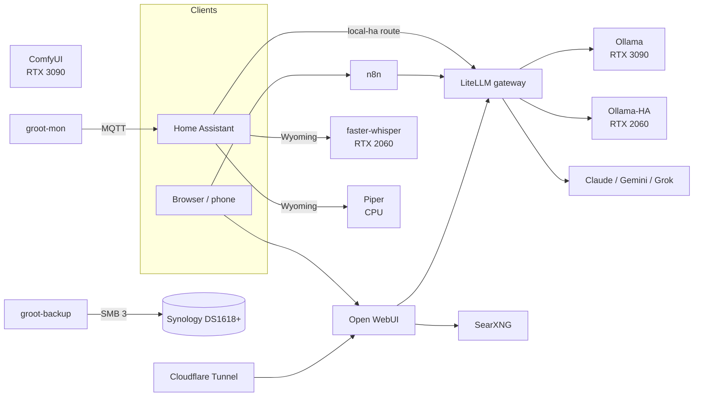

# groot-ai-hub

A bare-metal, private AI hub for a household: local LLMs, image/video generation, voice for Home Assistant, and metered access to cloud models (Claude, Gemini, Grok) behind one gateway.

Built and documented for a YouTube series. Everything here comes from the real, running machine ("groot"), scrubbed of secrets and LAN details by [`scripts/scrub.sh`](scripts/scrub.sh).

> 📺 **Video:** _link coming soon_

## What it runs

| Service | Role | GPU |
|---|---|---|
| Ollama | Local LLMs for chat and n8n (Qwen 27B always loaded; gpt-oss 120B on demand) | Main (RTX 3090) |
| Ollama-HA | `qwen3:8b`, always loaded, for Home Assistant voice | HA (RTX 2060 12GB) |
| faster-whisper (Wyoming) | Speech-to-text for HA Assist | HA |
| Piper (Wyoming) | Text-to-speech for HA Assist | CPU |
| LiteLLM + Postgres | One OpenAI-compatible gateway for local and cloud models, with per-route and global budget caps | — |
| Open WebUI | Chat front end; escalates to cloud models through an `ask_model` tool | — |
| n8n + Postgres | Automations | — |
| SearXNG | Private web search for the LLMs | — |
| cloudflared | Cloudflare Tunnel (plus Access) for remote use | — |
| ComfyUI (native, systemd) | Image and video generation | Main |
| groot-mon (systemd) | Health, update and security reporting to Home Assistant over MQTT | — |

Home Assistant voice reaches its model through LiteLLM's `local-ha` route, so it shares the gateway's keys, budgets and logs; see [docs/05](docs/05-home-assistant.md).

## Hardware

| Part | Spec |
|---|---|
| Board | MSI Z490-A PRO |
| CPU | Intel i7-10700KF |
| RAM | 128 GB DDR4 |
| GPU 1 | RTX 3090 Founders Edition, top x16 slot, power-limited to 325 W |
| GPU 2 | RTX 2060 12GB, chipset x16 slot (x4 electrical), dedicated to Home Assistant |
| PSU | Corsair 1000 W 80+ Bronze, modular |
| NAS (separate box) | Synology DS1618+ plus expansion unit; off-box target for the nightly backups (SMB 3) |
| OS | Ubuntu 26.04.1 LTS, kernel 7.0 |
| Driver | NVIDIA open kernel module 595.91.07 |
| Containers | Docker 29.9, nvidia-container-toolkit 1.20.1 |

Details: [docs/01-hardware.md](docs/01-hardware.md)

## Architecture



The two GPUs never share a model. Each service is pinned to one card by UUID; see [docs/04-multi-gpu.md](docs/04-multi-gpu.md).

## Repo layout

```
compose/          compose.yaml, .env.example, litellm/config.example.yaml, searxng/settings.example.yml
systemd/          GPU power limit, ComfyUI (+ gpu.conf drop-in), idle VRAM release, backup and
                  groot-mon timers, persistenced override, gpu.env.example
host/             docker daemon.json, unattended-upgrades NVIDIA blacklist, groot-mon.env.example
host/bin/         groot-backup, groot-mon, comfyui-idle-free  (install to /usr/local/bin)
home-assistant/   dashboard card, automations/ (groot-mon alerts), voice prompt template
open-webui/       ask_model tool, Groot system prompt template
scripts/          setup.sh, scrub.sh, update-image.sh, monthly-update.sh, groot-gpu-audit.sh, gpu-burn.py
docs/             step-by-step build notes
```

## Quick start

1. Build the host: Ubuntu, NVIDIA driver, Docker, nvidia-container-toolkit, and the model/backup disks mounted. See [docs/02](docs/02-ubuntu-nvidia.md).
2. Clone this repo on the server and run the setup script:

   ```bash
   git clone https://github.com/PdXGB/groot-ai-hub.git && cd groot-ai-hub
   sudo bash scripts/setup.sh
   ```

   It detects the GPUs and LAN IP, then asks for the hostnames, time zone, Cloudflare tunnel token, API keys, budgets, GPU power limit and the MQTT broker for groot-mon (blank skips an item). It generates the secrets and writes `/srv/ai` (compose, `.env`, LiteLLM and SearXNG configs, update scripts), `/etc/groot-ai/gpu.env` and the host files, then installs the systemd units and enables the timers. Re-runs never overwrite: they fill in missing values and list files that differ from the repo. `--help` shows the options.
3. Start the stack and pull the models (setup.sh prints these steps at the end):

   ```bash
   cd /srv/ai && docker compose up -d
   docker exec ai-ollama-1 ollama pull huihui_ai/Qwen3.8-abliterated:27b   # local-fast
   docker exec ai-ollama-1 ollama pull nomic-embed-text                    # embed
   docker exec ai-ollama-ha-1 ollama pull qwen3:8b                         # local-ha
   ```

4. Create LiteLLM virtual keys for clients: [docs/03](docs/03-docker-stack.md)
5. Check the GPU pinning: [docs/04](docs/04-multi-gpu.md)
6. Connect Home Assistant: [docs/05](docs/05-home-assistant.md)

Secrets live only in `/srv/ai/.env` (mode 600), outside the clone. `compose/.env.example` documents every variable. Back up `.env`: the n8n encryption key can't be recovered without it.

## Docs

1. [Hardware](docs/01-hardware.md)
2. [Ubuntu + NVIDIA driver](docs/02-ubuntu-nvidia.md)
3. [Docker stack](docs/03-docker-stack.md)
4. [Two GPUs, pinned by UUID](docs/04-multi-gpu.md)
5. [Home Assistant voice + LLM](docs/05-home-assistant.md)
6. [Model routing: Groot and `ask_model`](docs/06-model-routing.md)
7. [Knowledge base (RAG)](docs/07-knowledge-base.md)
8. [ComfyUI: image and video](docs/08-comfyui.md)
9. [Monitoring: groot-mon](docs/09-monitoring.md)
10. [Backups](docs/10-backups.md)
11. [Updates](docs/11-updates.md)

[Troubleshooting](docs/troubleshooting.md)

## License

- **Code and configs:** MIT. See [LICENSE](LICENSE).
- **Written guides in `docs/`:** [CC BY 4.0](docs/LICENSE). Reuse them freely, with credit and a link back to this repo.
