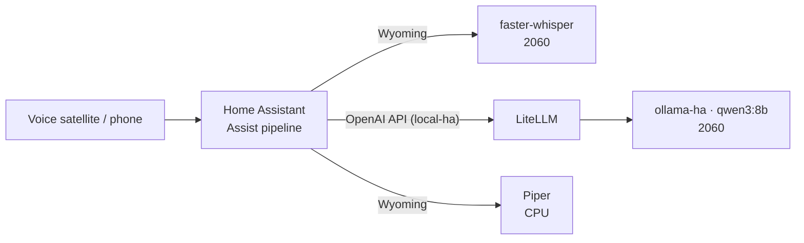

# 05 — Home Assistant voice + LLM

Home Assistant gets three things from groot, all on the RTX 2060 or the CPU so voice never waits for the 3090:

| Piece | Service | Where | HA integration |
|---|---|---|---|
| Speech-to-text | faster-whisper (`distil-large-v3`) | 2060 | Wyoming, port 10300 |
| Text-to-speech | Piper (`en_US-lessac-medium`) | CPU | Wyoming, port 10200 |
| Conversation LLM | `qwen3:8b` in `ollama-ha`, through LiteLLM route `local-ha` | 2060 | Extended OpenAI Conversation |



## 1. Speech: Wyoming (Whisper + Piper)

Both containers bind to groot's LAN address (`${GROOT_LAN_IP}` in [`compose.yaml`](../compose/compose.yaml)) so Home Assistant can reach them. LiteLLM (port 4000) also binds there; Open WebUI (3000) and n8n (5678) listen on all interfaces; Ollama, `ollama-ha` and SearXNG are localhost-only. See [03-docker-stack.md](03-docker-stack.md).

In Home Assistant: **Settings → Devices & services → Add integration → Wyoming Protocol**, twice:

- `<groot LAN IP>` port `10300` (Whisper)
- `<groot LAN IP>` port `10200` (Piper)

Whisper is pinned to the 2060 with the `x-gpu-ha` anchor and uses about 1.9 GB of VRAM. See [04-multi-gpu.md](04-multi-gpu.md).

## 2. The HA model: `ollama-ha` on the 2060

A second Ollama container holds one small model, loaded permanently:

```yaml
  ollama-ha:
    image: ollama/ollama:0.40.11
    <<: *gpu_ha                                      # 2060 only
    ports: ["127.0.0.1:11435:11434"]                 # localhost only; LiteLLM uses the Docker network
    volumes: ["/srv/models/ollama-ha:/root/.ollama"] # own model store
    environment:
      OLLAMA_KEEP_ALIVE: "-1"
      OLLAMA_MAX_LOADED_MODELS: 1
      OLLAMA_CONTEXT_LENGTH: 16384
      OLLAMA_FLASH_ATTENTION: 1
      OLLAMA_KV_CACHE_TYPE: q8_0
```

Why a separate instance instead of the main Ollama: the main one swaps models (the 120B evicts the 27B on demand) and the 3090 also runs ComfyUI. A dedicated instance on its own card means a voice command never waits behind a video render or a model swap.

```bash
cd /srv/ai && docker compose up -d ollama-ha
docker exec ai-ollama-ha-1 ollama pull qwen3:8b
docker exec ai-ollama-ha-1 ollama ps        # qwen3:8b  6.3 GB  100% GPU  Forever (after first use)
```

The 2060 then holds Whisper (~1.9 GB) plus the model (~6.3 GB with a 16k context), about 8 of its 12 GB.

### Picking the model

Measured on the 2060 with a 6k-token, Home-Assistant-sized prompt and thinking off:

| Model | Prompt read (uncached) | Same prompt again (cached) | Generation |
|---|---|---|---|
| `qwen3:8b` | ~1,270 tok/s (4.9 s) | 0.2 s | ~48 tok/s |
| `llama3.1:8b` | ~1,380 tok/s (3.5 s) | 0.2 s | ~50 tok/s |

Speed is a wash, so the choice is about tool calling, where the Qwen 3 family is strong. `qwen3:8b` it is.

## 3. LiteLLM route

Home Assistant talks to LiteLLM, not to Ollama directly, so it gets the same keys, budgets and logs as everything else ([`config.example.yaml`](../compose/litellm/config.example.yaml)):

```yaml
  - model_name: local-ha
    litellm_params:
      model: ollama_chat/qwen3:8b
      api_base: http://ollama-ha:11434
      keep_alive: -1
      think: false        # Qwen 3 ignores /no_think in the prompt; this is what turns thinking off
```

Restart LiteLLM after editing its config (`docker compose restart litellm`).

Give Home Assistant its own LiteLLM **virtual key**, limited to the routes it should use and with its own budget, rather than the master key ([docs/03](03-docker-stack.md#virtual-keys) has the command).

## 4. Conversation agent: Extended OpenAI Conversation

Install it from HACS, then add it with:

- **Base URL:** `http://<groot LAN IP>:4000/v1`
- **API key:** the Home Assistant virtual key
- **Model:** `local-ha`

Options that matter:

- **Prompt template:** use [`home-assistant/extended-openai-prompt-template.txt`](../home-assistant/extended-openai-prompt-template.txt). It **must keep the `exposed_entities` block**; pasting a plain prompt over the whole template leaves the model blind to your devices.
- **Maximum function calls per conversation:** 2–3.
- Expose only the entities voice should control (**Settings → Voice assistants → Expose**). Every exposed entity is a line in every prompt; groot went from about 600 to under 300.

Then build the pipeline: **Settings → Voice assistants → Add assistant**: conversation agent = Extended OpenAI Conversation, STT = faster-whisper, TTS = Piper, and turn on **Prefer handling commands locally**. Simple commands ("turn on the kitchen lights") are then handled by Home Assistant's own intents instantly, and only what it can't parse reaches the LLM.

## 5. Make the prompt cacheable

Home Assistant sends the whole device list with every request: about **7,000 tokens** on groot. Ollama can skip re-reading the part of a prompt that matches the previous request, but only up to the first character that differs. So the template is ordered from most stable to least:

1. Instructions (never change)
2. Devices whose state rarely changes: lights, switches, locks, climate
3. Fast-changing devices: `sensor`, `binary_sensor`, `media_player`, `weather`, `sun`, `person`, `device_tracker`
4. The current time, last

Measured on groot (LiteLLM logs, ~7k-token prompts):

| Setup | Time per AI request |
|---|---|
| Before: 27B on the 3090, time at the top of the prompt | 8–10 s every time |
| `qwen3:8b` on the 2060, cache cold | 5.8 s |
| `qwen3:8b` on the 2060, cache warm | **0.4 s** |

To check your own numbers:

```bash
cd /srv/ai && docker compose exec -T litellm-db sh -c 'psql -U "$POSTGRES_USER" -d "${POSTGRES_DB:-$POSTGRES_USER}"' <<'SQL'
SELECT "startTime"::timestamp(0), model, prompt_tokens, completion_tokens,
       round(extract(epoch FROM ("endTime" - "startTime"))::numeric, 1) AS secs
FROM "LiteLLM_SpendLogs" WHERE model_group = 'local-ha' ORDER BY "startTime" DESC LIMIT 10;
SQL
```

## 6. Safety

The prompt asks for a spoken "yes" before unlocking a door, opening a garage door or gate, disarming the alarm, or turning off the well pump. Everything else (lights, setpoints) acts immediately; confirming every light gets old fast. The stock Extended OpenAI template tells the model to confirm every service call, so that line is removed.

This is a prompt rule, not a hard lock. For anything where a wrong action is costly, also limit what's exposed, or keep it out of voice entirely.

## 7. Monitoring

groot reports to Home Assistant as an MQTT device (`host/bin/groot-mon`): both GPUs, Ollama (including which models are loaded), every container (including `ollama-ha`), LiteLLM, disks, backups, updates and security tripwires. The dashboard card and alert automations are in [`home-assistant/`](../home-assistant/); setup is in [docs/09](09-monitoring.md).

## 8. Groot controls the house: HA's MCP server

The other direction: Open WebUI models (Groot, [docs/06](06-model-routing.md)) can read and control Home Assistant through HA's built-in **Model Context Protocol Server** integration. Open WebUI connects to it natively; no `mcpo` proxy is needed.

1. **Settings → Devices & services → Add integration → Model Context Protocol Server.** Use the **Assist** API only; leave the option to expose all LLM APIs off. The model can then touch only the entities exposed to Assist, the same list voice uses.
2. Create a dedicated HA user for it: **not an administrator**, **local access only**. Log in as that user and create a long-lived access token (profile → Security).
3. Open WebUI: **Admin Panel → Settings → External Tools → +**, type **MCP (Streamable HTTP)**, URL `http://<HA LAN IP>:8123/api/mcp`, auth **Bearer** with that token.

A non-admin, local-only account limits what a leaked token can do. The Groot prompt asks for confirmation before locks, HVAC setpoints, alarms and pumps; as with voice, that's a prompt rule, so keep what's exposed to Assist tight.

## Later

- **Frigate** on the 2060 (`-tensorrt` image) for camera object detection. Budget about 1.5–2 GB of VRAM; the 2060 has room.
